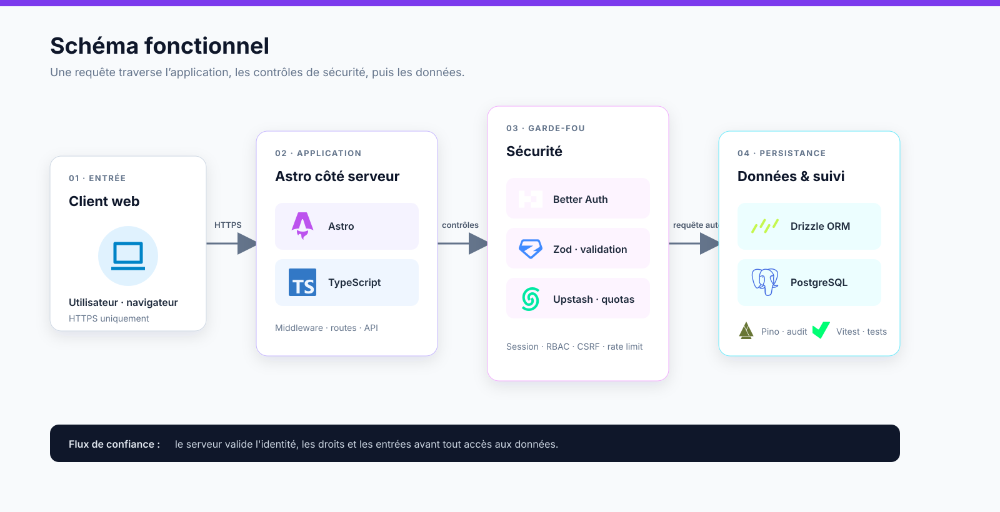

# Powehi Astro SaaS Security Kit

Pack défensif pour auditer et renforcer une application SaaS construite avec Astro. Il fournit des prompts spécialisés, des checklists opérationnelles et des modèles réutilisables pour structurer une revue de sécurité sans exposer de secrets.

> [!WARNING]
> Ce kit ne remplace ni un audit de sécurité certifié, ni une revue juridique, ni les tests de l'équipe qui maintient l'application. Les résultats produits par une IA sont des hypothèses à vérifier par des preuves, des tests et une revue humaine.

## Sommaire

- [Objectifs](#objectifs)
- [Contenu du kit](#contenu-du-kit)
- [Démarrage rapide](#démarrage-rapide)
- [Méthode de revue](#méthode-de-revue)
- [Catalogue des prompts](#catalogue-des-prompts)
- [Checklists](#checklists)
- [Modèles](#modèles)
- [Règles de sécurité pour l'IA](#règles-de-sécurité-pour-lia)
- [Référentiels](#référentiels)
- [Intégration dans un projet Astro](#intégration-dans-un-projet-astro)
- [Avant une mise en production](#avant-une-mise-en-production)
- [Intégrité et version](#intégrité-et-version)
- [Contribution et signalement](#contribution-et-signalement)
- [Limites](#limites)

## Objectifs

Le kit aide à :

- modéliser les actifs, acteurs, flux et frontières de confiance ;
- examiner l'authentification, les sessions et l'autorisation côté serveur ;
- vérifier les entrées, les sorties, les API, les webhooks et les téléversements ;
- limiter les risques XSS, CSRF, CORS, IDOR/BOLA, fuite de secrets et isolation inter-tenant ;
- préparer les en-têtes HTTP, les logs, les alertes, le rate limiting et la réponse à incident ;
- produire des constats traçables avec preuve, impact, correctif et test de non-régression.

## Contenu du kit

```text
.
├── prompts/       # 20 prompts de revue spécialisés
├── checklists/    # 10 contrôles opérationnels
├── templates/     # 6 modèles de livrables et de configuration
├── references/    # repères OWASP
├── QUICKSTART.md  # rappel d'utilisation en cinq étapes
├── SECURITY.md    # politique de signalement
├── MANIFEST.md    # empreintes SHA-256 des fichiers distribués
├── CHANGELOG.md   # historique des versions
└── LICENSE        # licence du kit
```

## Démarrage rapide

### 1. Préparer le périmètre

Décrivez l'application, ses environnements, ses utilisateurs, ses tenants, ses données sensibles, ses fournisseurs et les routes concernées. Ne copiez que le code minimal nécessaire à la question.

### 2. Installer le rôle système

Commencez par [`prompts/00-system-security-reviewer.md`](prompts/00-system-security-reviewer.md). Il impose une analyse défensive, basée sur des preuves, avec sévérité, scénario d'abus, emplacement, correctif, test et incertitudes.

### 3. Choisir le prompt spécialisé

Ajoutez un prompt de [`prompts/`](prompts/) correspondant au domaine à examiner et remplacez ses marqueurs (`<ARCHITECTURE>`, `<CODE_AUTH>`, `<ROUTES_ET_POLICIES>`, etc.) par un contexte anonymisé.

### 4. Exiger un résultat vérifiable

Demandez systématiquement :

1. le constat et sa sévérité ;
2. la preuve exacte dans le périmètre fourni ;
3. le scénario d'abus et l'impact ;
4. le correctif minimal ;
5. le test de non-régression ;
6. les hypothèses et les éléments manquants.

### 5. Valider avant livraison

Passez [`checklists/pre-release.md`](checklists/pre-release.md), puis les checklists spécialisées liées aux changements. Aucun résultat généré automatiquement ne doit être considéré comme validé sans revue humaine et test dans l'environnement cible.

## Méthode de revue



### Lecture du schéma

Le flux se lit de gauche à droite :

1. **Client web** — l'utilisateur envoie une requête exclusivement via HTTPS.
2. **Application Astro + TypeScript** — le middleware, les routes serveur et les API reçoivent la requête. Les contrôles importants restent côté serveur.
3. **Couche sécurité** — Better Auth gère l'identité et les sessions, Zod valide les entrées, et Upstash applique les quotas et la limitation de débit. Cette couche décide si la requête peut continuer.
4. **Données et suivi** — Drizzle ORM exécute des requêtes typées vers PostgreSQL. Pino journalise les événements utiles à l'audit et Vitest vérifie les comportements attendus.

Le principe central est simple : **aucun accès aux données n'est autorisé avant validation de l'identité, des droits, des entrées et du quota**. Les tests négatifs doivent couvrir au minimum l'utilisateur non connecté, le rôle insuffisant, le tenant différent, le token expiré et la requête rejouée.

Le schéma représente l'architecture cible du kit. Il ne signifie pas que ces dépendances sont déjà installées dans ce dépôt : chaque projet doit confirmer ses choix de framework, d'authentification, de stockage et d'observabilité.

La méthode de revue associée est : périmètre → actifs et flux → prompts spécialisés → preuves minimales → risques → correctifs côté serveur → tests de non-régression → checklist pré-release.

### Format recommandé d'un constat

| Champ | Attendu |
| --- | --- |
| Identifiant | Référence stable, par exemple `AUTH-001` |
| Sévérité | Critique, haute, moyenne, basse ou information |
| Preuve | Fichier, ligne, route ou configuration observée |
| Scénario | Action réalisable par quel acteur et dans quelles conditions |
| Impact | Confidentialité, intégrité, disponibilité ou vie privée |
| Correctif | Changement minimal et localisable |
| Validation | Test positif, test négatif et résultat attendu |
| Incertitudes | Hypothèses à confirmer avant décision |

## Catalogue des prompts

Tous les prompts supposent un périmètre autorisé, un contexte anonymisé et une analyse sans secret réel.

| Prompt | Sujet | Questions principales |
| --- | --- | --- |
| [`00-system-security-reviewer`](prompts/00-system-security-reviewer.md) | Rôle système | Comment produire des constats défensifs et prouvés ? |
| [`01-threat-model`](prompts/01-threat-model.md) | Modèle de menace | Quels actifs, flux et risques STRIDE ? |
| [`02-authentication-review`](prompts/02-authentication-review.md) | Authentification | Inscription, connexion, reset, MFA, anti-énumération et débit |
| [`03-authorization-review`](prompts/03-authorization-review.md) | Autorisation | Matrice rôle × ressource × action, IDOR/BOLA et tenants |
| [`04-session-cookies`](prompts/04-session-cookies.md) | Sessions | Rotation, révocation, fixation et attributs de cookies |
| [`05-input-validation`](prompts/05-input-validation.md) | Entrées | Schémas, tailles, normalisation et champs inconnus |
| [`06-xss-csp`](prompts/06-xss-csp.md) | XSS / CSP | Sorties HTML, scripts, URL et politique CSP progressive |
| [`07-csrf-cors`](prompts/07-csrf-cors.md) | CSRF / CORS | Origines, méthodes, tokens et credentials |
| [`08-api-security`](prompts/08-api-security.md) | API | Authentification objet/fonction, pagination, quotas et erreurs |
| [`09-database-tenant-isolation`](prompts/09-database-tenant-isolation.md) | Données | Requêtes paramétrées, tenant obligatoire, RLS et migrations |
| [`10-file-upload`](prompts/10-file-upload.md) | Fichiers | Taille, type réel, stockage, antivirus et archives |
| [`11-webhooks`](prompts/11-webhooks.md) | Webhooks | Signature brute, anti-rejeu, idempotence et ordre |
| [`12-payments`](prompts/12-payments.md) | Paiements | Source de vérité, prix serveur, webhooks et concurrence |
| [`13-secrets-env`](prompts/13-secrets-env.md) | Secrets | Variables publiques/serveur, bundle, logs et rotation |
| [`14-dependencies-supply-chain`](prompts/14-dependencies-supply-chain.md) | Supply chain | Lockfile, scripts, provenance, CI et mises à jour |
| [`15-security-headers`](prompts/15-security-headers.md) | En-têtes | CSP, HSTS, frame-ancestors, nosniff, cache et permissions |
| [`16-logging-monitoring`](prompts/16-logging-monitoring.md) | Logs | Événements, corrélation, masquage, rétention et alertes |
| [`17-error-handling`](prompts/17-error-handling.md) | Erreurs | Traces, SQL, chemins, fournisseurs et messages publics |
| [`18-rate-limiting-abuse`](prompts/18-rate-limiting-abuse.md) | Abus | Clés, fenêtres, burst, coûts, 429 et mode dégradé |
| [`19-ci-cd-review`](prompts/19-ci-cd-review.md) | CI/CD | Permissions, actions épinglées, forks, OIDC et artefacts |

## Checklists

| Checklist | Quand l'utiliser |
| --- | --- |
| [`ai-safe-use`](checklists/ai-safe-use.md) | À chaque échange avec un modèle |
| [`api`](checklists/api.md) | Avant d'exposer ou modifier une API |
| [`astro-config`](checklists/astro-config.md) | Lors d'un changement Astro, adaptateur ou runtime |
| [`authentication`](checklists/authentication.md) | Pour tout flux d'identité ou de session |
| [`authorization`](checklists/authorization.md) | Pour les rôles, permissions et tenants |
| [`database`](checklists/database.md) | Pour schéma, requêtes, migrations et sauvegardes |
| [`deployment`](checklists/deployment.md) | Avant un déploiement dans un environnement cible |
| [`incident-response`](checklists/incident-response.md) | Pour préparer ou exercer une réponse à incident |
| [`pre-release`](checklists/pre-release.md) | Gate obligatoire avant publication |
| [`privacy`](checklists/privacy.md) | Pour les données personnelles, rétention et sous-traitants |

## Modèles

- [`env.example`](templates/env.example) : variables factices ; ne jamais y placer un secret réel.
- [`incident-runbook.md`](templates/incident-runbook.md) : alerte, responsable, confinement, preuves, restauration et retour d'expérience.
- [`responsible-disclosure.md`](templates/responsible-disclosure.md) : canal privé et informations minimales pour un signalement.
- [`security-issue.md`](templates/security-issue.md) : fiche de vulnérabilité avec preuve, impact, correction et test.
- [`security-review-report.md`](templates/security-review-report.md) : rapport avec périmètre, résumé, constats et risques acceptés.
- [`threat-model.md`](templates/threat-model.md) : actifs, acteurs, frontières, flux et menaces.

## Règles de sécurité pour l'IA

- Minimisez le code et les données transmis.
- Remplacez les secrets, tokens, cookies, clés, identifiants et données personnelles par des marqueurs.
- N'envoyez pas de fichier ou de contexte appartenant à un tiers sans autorisation.
- Considérez toute sortie d'IA comme une hypothèse, jamais comme une preuve autonome.
- Refusez les tests sur un système tiers sans autorisation explicite.
- Demandez des tests sûrs, reproductibles et sans charge offensive.
- Ne demandez jamais au modèle de reproduire un secret ; il doit uniquement indiquer son emplacement et l'action de rotation.

## Référentiels

Les repères sont regroupés dans [`references/owasp-map.md`](references/owasp-map.md). Pour un audit formel, vérifiez toujours la version et la source officielle de : OWASP ASVS, OWASP Top 10 Web, OWASP Top 10 API et OWASP Cheat Sheet Series.

## Intégration dans un projet Astro

1. Identifiez les routes publiques, protégées et mutantes.
2. Confirmez ce qui s'exécute côté serveur et ce qui peut être envoyé au navigateur.
3. Cartographiez les variables publiques et privées dans la configuration Astro.
4. Définissez la matrice tenant × rôle × ressource × action.
5. Faites relire les contrôles côté serveur avant ceux de l'interface.
6. Ajoutez les tests négatifs : utilisateur non connecté, rôle insuffisant, tenant différent, token expiré et requête rejouée.
7. Vérifiez les logs et les bundles afin qu'aucun secret ne soit exposé.

## Avant une mise en production

La checklist [`pre-release.md`](checklists/pre-release.md) doit être accompagnée des preuves suivantes : tests négatifs d'authentification et d'autorisation, recherche de secrets dans le dépôt/bundle/logs, audit des dépendances et du lockfile, vérification des en-têtes, test de sauvegarde et de rollback, monitoring et contact d'urgence.

## Intégrité et version

La version actuelle est `v0.1.0`. Les empreintes SHA-256 de la distribution sont conservées dans [`MANIFEST.md`](MANIFEST.md). Après toute modification d'un fichier distribué, régénérez le manifeste avant publication.

```bash
sha256sum README.md
```

```powershell
Get-FileHash -Algorithm SHA256 README.md
```

L'historique est disponible dans [`CHANGELOG.md`](CHANGELOG.md).

## Contribution et signalement

Les contributions doivent rester défensives, reproductibles et documentées. Une proposition de contrôle doit préciser le modèle de menace, les hypothèses, le correctif minimal et les tests associés.

Ne publiez pas de vulnérabilité exploitable dans une issue publique. Suivez [`SECURITY.md`](SECURITY.md) et utilisez le canal privé du mainteneur avec une reproduction minimale, l'impact et le correctif suggéré, sans secret ni donnée personnelle.

## Limites

Ce dépôt fournit une méthode et des artefacts de revue ; il ne garantit pas la sécurité d'une application. Il ne remplace pas une analyse de code complète, un test d'intrusion autorisé, une revue d'architecture cloud, une validation juridique ou la surveillance après déploiement.

## Licence

Consultez [`LICENSE`](LICENSE) pour les conditions de distribution.
